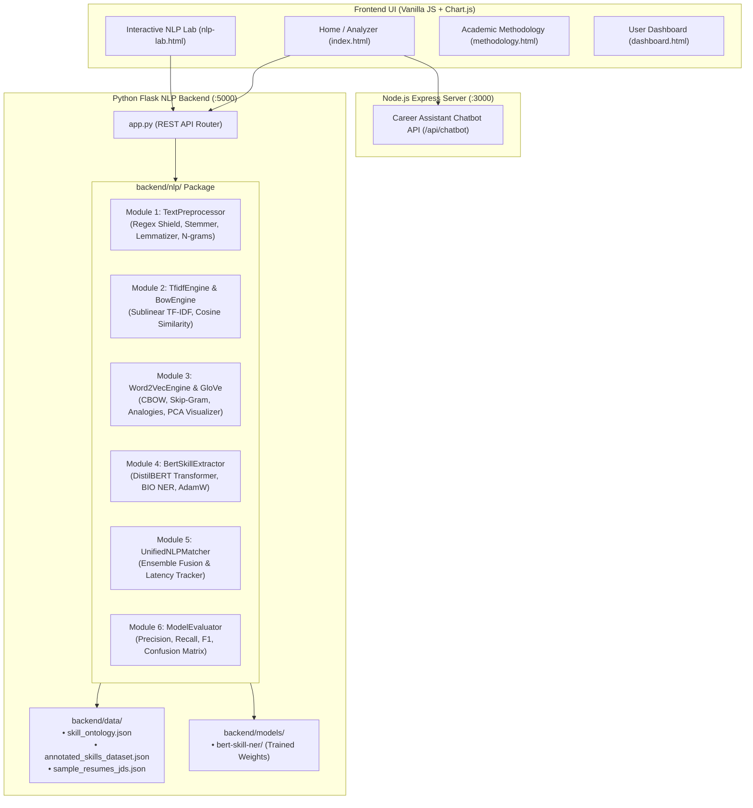

# SkillGap AI 🎯 — Deep Learning for NLP Academic Project
### Course Alignment: **CSE472: Deep Learning for Natural Language Processing (2026–27)**

[](https://www.python.org/)
[](https://pytorch.org/)
[](https://huggingface.co/)
[](https://radimrehurek.com/gensim/)
[](https://scikit-learn.org/)
[]()

---

## 📖 Executive Summary

**SkillGap AI** is an advanced career analytics platform and interactive academic laboratory upgraded to fulfill the requirements of **CSE472: Deep Learning for Natural Language Processing**. It evaluates candidate resumes against target job descriptions across four distinct mathematical and deep learning paradigms:

1. **Rule-Based & Ontology Matching:** Exact keyword lookups mapped against a 36-skill technical taxonomy.
2. **Lexical Vector Spaces (Unit I):** Sublinear TF-IDF and Bag-of-Words representations evaluated with true Cosine similarity.
3. **Continuous Word Embeddings (Unit II):** Distributed dense representations using Gensim Word2Vec (CBOW and Skip-Gram) and GloVe, augmented with category-constrained semantic similarity and PCA 2D projection.
4. **Contextual Transformer Encoder (Unit V):** Fine-tuned **DistilBERT** (`distilbert-base-uncased`) token classification utilizing BIO entity tags (`B-SKILL`, `I-SKILL`, `O`) with subword reassembly.

The platform provides both a full-stack career dashboard and an **Interactive NLP Laboratory (`nlp-lab.html`)** where students, instructors, and evaluators can inspect every intermediate step of the NLP pipeline.

---

## 🎓 CSE472 Syllabus Alignment Matrix

| Course Unit | Theoretical Topic | Implemented Module | Primary Source File | Interactive Demonstration |
| :--- | :--- | :--- | :--- | :--- |
| **Unit I** | Text Processing & Morphology | 13-stage text normalization, symbol protection (`C++`, `C#`, `.NET`, `Node.js`, `CI/CD`), Porter stemming, WordNet lemmatization, N-grams. | [`backend/nlp/preprocessing.py`](backend/nlp/preprocessing.py) | **NLP Lab: Tab 1** (`nlp-lab.html`) |
| **Unit I** | Bag-of-Words & TF-IDF Vector Space | `CountVectorizer`, `TfidfVectorizer` with sublinear scaling ($1 + \log(\text{TF})$), mathematical Cosine similarity ($\cos(\mathbf{A}, \mathbf{B})$), joint term importance. | [`backend/nlp/tfidf_engine.py`](backend/nlp/tfidf_engine.py)<br>[`backend/nlp/bow_engine.py`](backend/nlp/bow_engine.py) | **NLP Lab: Tab 2** (`nlp-lab.html`) |
| **Unit II** | Distributed Word Embeddings | Gensim Word2Vec (CBOW & Skip-Gram with Negative Sampling) + GloVe vectors, semantic similarity with ontological constraints, vector analogies ($\mathbf{v}_A - \mathbf{v}_B + \mathbf{v}_C \approx \mathbf{v}_D$). | [`backend/nlp/word2vec_engine.py`](backend/nlp/word2vec_engine.py)<br>[`backend/nlp/glove_engine.py`](backend/nlp/glove_engine.py) | **NLP Lab: Tab 3** (`nlp-lab.html`) |
| **Unit II** | Dimensionality Reduction | Principal Component Analysis (PCA) projecting high-dimensional dense skill vectors into 2D $\mathbb{R}^2$ with category clustering and variance ratios. | [`backend/nlp/embedding_visualizer.py`](backend/nlp/embedding_visualizer.py) | **NLP Lab: Tab 3** (`nlp-lab.html`) |
| **Unit V** | Pretrained Transformers | DistilBERT 6-layer Transformer Encoder with 768 hidden dimension and 12 Multi-Head Self-Attention heads. | [`backend/nlp/bert_extractor.py`](backend/nlp/bert_extractor.py) | **NLP Lab: Tab 4** (`nlp-lab.html`) |
| **Unit V** | Named Entity Recognition (NER) | Token classification head trained on annotated skills dataset with BIO tags (`B-SKILL`, `I-SKILL`, `O`) and WordPiece subword continuation handling (`##`). | [`backend/nlp/bert_extractor.py`](backend/nlp/bert_extractor.py)<br>[`backend/nlp/dataset_loader.py`](backend/nlp/dataset_loader.py) | **NLP Lab: Tab 4** (`nlp-lab.html`) |
| **Synthesis** | Multimodal Ensemble & Benchmarking | Weighted fusion score ($0.25 \times \text{Rule} + 0.25 \times \text{TFIDF} + 0.25 \times \text{W2V} + 0.25 \times \text{BERT}$), Precision, Recall, F1, Latency, and Confusion Matrix. | [`backend/nlp/unified_matcher.py`](backend/nlp/unified_matcher.py)<br>[`backend/nlp/model_evaluation.py`](backend/nlp/model_evaluation.py) | **NLP Lab: Tab 5** (`nlp-lab.html`) |

---

## 📐 Mathematical Formulations

### 1. TF-IDF & Cosine Similarity (Unit I)
Sublinear term-frequency scaling prevents term-frequency dominance in long candidate resumes:
$$\text{TF}(t, d) = \begin{cases} 1 + \log(\text{count}(t, d)) & \text{if } \text{count}(t, d) > 0 \\ 0 & \text{otherwise} \end{cases}$$

Inverse Document Frequency (IDF) smooths corpus-wide document frequency:
$$\text{IDF}(t) = \log\left(\frac{1 + N}{1 + \text{DF}(t)}\right) + 1$$

Cosine similarity calculates the angular orientation of L2-normalized sparse document vectors:
$$\cos(\mathbf{A}, \mathbf{B}) = \frac{\mathbf{A} \cdot \mathbf{B}}{\|\mathbf{A}\|_2 \|\mathbf{B}\|_2} = \frac{\sum_{i=1}^V A_i B_i}{\sqrt{\sum_{i=1}^V A_i^2} \sqrt{\sum_{i=1}^V B_i^2}}$$

### 2. Skip-Gram Objective Function with Negative Sampling (Unit II)
Word2Vec maximizes the probability of predicting context words $w_{t+j}$ given target word $w_t$:
$$\mathcal{L}_{\text{Skip-Gram}} = \sum_{t=1}^T \sum_{-c \le j \le c, j \neq 0} \left[ \log \sigma(\mathbf{v}'_{w_{t+j}}{}^\top \mathbf{v}_{w_t}) + \sum_{k=1}^K \mathbb{E}_{w_{n,k} \sim P_n(w)}\left[\log \sigma(-\mathbf{v}'_{w_{n,k}}{}^\top \mathbf{v}_{w_t})\right] \right]$$

### 3. Scaled Dot-Product Self-Attention (Unit V)
$$\text{Attention}(\mathbf{Q}, \mathbf{K}, \mathbf{V}) = \text{softmax}\left(\frac{\mathbf{Q}\mathbf{K}^\top}{\sqrt{d_k}}\right)\mathbf{V}$$

### 4. Transparent Multimodal Scoring Formula
$$\text{Score}_{\text{Unified}} = 0.25 \times S_{\text{Rule}} + 0.25 \times S_{\text{TFIDF}} + 0.25 \times S_{\text{Word2Vec}} + 0.25 \times S_{\text{BERT}}$$

---

## 🏛️ System Architecture



---

## 📁 Project Directory Structure

```
skillgap-ai/
├── backend/                             # Python Deep Learning NLP Backend
│   ├── app.py                           # Flask REST API server (port 5000)
│   ├── requirements.txt                 # Backend dependencies (PyTorch, Transformers, Gensim, etc.)
│   ├── resume_skill_extractor.py        # Resume extraction orchestrator
│   ├── data/
│   │   ├── skill_ontology.json          # 36 technical skills taxonomy across 8 categories
│   │   ├── annotated_skills_dataset.json# Gold-standard BIO-annotated dataset (Train/Val/Test)
│   │   └── sample_resumes_jds.json      # Benchmark resumes & JDs with ground truth
│   ├── models/
│   │   ├── README.md                    # Model weights documentation
│   │   └── bert-skill-ner/              # Fine-tuned DistilBERT token classifier weights
│   ├── nlp/                             # Modular CSE472 NLP Package
│   │   ├── __init__.py                  # Package init
│   │   ├── preprocessing.py             # Unit I: Symbol-safe 13-stage preprocessor
│   │   ├── bow_engine.py                # Unit I: Bag-of-Words CountVectorizer
│   │   ├── tfidf_engine.py              # Unit I: TF-IDF & Cosine Similarity
│   │   ├── similarity_engine.py         # Distance metrics (Cosine, Euclidean, Manhattan, Jaccard)
│   │   ├── word2vec_engine.py           # Unit II: Word2Vec CBOW & Skip-Gram
│   │   ├── glove_engine.py              # Unit II: GloVe dense vectors
│   │   ├── embedding_visualizer.py      # Unit II: PCA 2D projection & clustering
│   │   ├── dataset_loader.py            # Unit V: WordPiece-aligned BIO dataset loader
│   │   ├── bert_extractor.py            # Unit V: DistilBERT token classifier & fine-tuning
│   │   ├── unified_matcher.py           # Module 5: Multimodal ensemble matcher
│   │   └── model_evaluation.py          # Module 6: Comparative evaluation benchmark
│   └── tests/                           # Comprehensive Pytest Suite (31 tests)
│       ├── test_preprocessing.py        # Tests for Unit I preprocessor
│       ├── test_tfidf.py                # Tests for Unit I BoW & TF-IDF math
│       ├── test_embeddings.py           # Tests for Unit II Word2Vec & GloVe & PCA
│       ├── test_bert.py                 # Tests for Unit V DistilBERT & BIO tags
│       ├── test_matching.py             # Tests for Module 5 & 6 Unified Matcher & Benchmarks
│       └── test_api_endpoints.py        # End-to-end REST API client tests
│
├── SkillGapAI-Frontend/                 # Client UI (HTML5 / Vanilla JS / CSS)
│   ├── index.html                       # Main Resume Analyzer + Academic Deep Dive
│   ├── nlp-lab.html                     # Dedicated Interactive NLP Laboratory
│   ├── methodology.html                 # Comprehensive Academic Syllabus Guide (KaTeX rendered)
│   ├── dashboard.html                   # Overview & Analytics Dashboard
│   ├── roadmap.html                     # 30/60/90-day learning roadmap
│   ├── jobs.html                        # Role recommendations
│   ├── compare.html                     # Side-by-side profile compare
│   ├── history.html                     # Analysis history
│   ├── settings.html                    # Theme & configuration
│   ├── about.html                       # System specifications
│   ├── css/
│   │   ├── styles.css                   # Master stylesheet (theme tokens)
│   │   ├── features.css                 # Feature cards & progress bars
│   │   └── chatbot.css                  # Floating AI career assistant
│   └── js/
│       ├── app.js                       # Frontend analysis orchestrator
│       ├── nlp-dashboard.js             # Academic deep-dive controller
│       ├── nlp-lab.js                   # Interactive NLP laboratory controller
│       ├── chatbot.js                   # AI career assistant widget
│       ├── pdf-export.js                # PDF analysis report generator
│       ├── theme-loader.js              # Theme initialization
│       └── theme-toggle.js              # Dark / light theme toggle
│
├── server.js                            # Node.js Express server for Chatbot (port 3000)
├── start_skillgap_backend.bat           # Windows 1-click startup batch script
└── README.md                            # Comprehensive Academic Documentation
```

---

## ⚡ Quick Start & Setup Guide

### Prerequisites
- **Python 3.9+** (Tested on Python 3.10)
- **Node.js 18+**
- **Modern Web Browser** (Chrome, Edge, Firefox)

---

### Step 1: Start the Python Flask NLP Backend (Port 5000)

#### Option A: Quick-Start Batch File (Windows)
Double-click:
```cmd
start_skillgap_backend.bat
```

#### Option B: Terminal Command
```bash
# Activate virtual environment
# Windows:
.\.venv\Scripts\activate

# macOS / Linux:
source .venv/bin/activate

# Install dependencies (already pre-installed in workspace .venv)
pip install -r backend/requirements.txt

# Launch Flask server
python backend/app.py
```
*The NLP backend will launch on `http://127.0.0.1:5000` with pre-cached models loaded in memory.*

---

### Step 2: Start the Node.js Chatbot Backend (Port 3000)

In a second terminal window:
```bash
npm start
```
*The Chatbot API server will launch on `http://localhost:3000`.*

---

### Step 3: Open the Frontend

You can open `SkillGapAI-Frontend/index.html` directly in your browser, or serve it using Python:
```bash
python -m http.server 8080
```
Then navigate to:
- **Main Skill Gap Analyzer:** `http://localhost:8080/SkillGapAI-Frontend/index.html`
- **Interactive NLP Lab:** `http://localhost:8080/SkillGapAI-Frontend/nlp-lab.html`
- **Academic Methodology Guide:** `http://localhost:8080/SkillGapAI-Frontend/methodology.html`

---

## 🧪 Running the Academic Test Suite

SkillGap AI includes a 31-test test suite verifying every component from raw character boundary handling to subword sub-token reassembly and API endpoints.

Execute the test suite with:
```bash
.\.venv\Scripts\python.exe -m pytest backend\tests -v
```

### Test Suite Summary:
```text
============================= test session starts =============================
backend/tests/test_api_endpoints.py::test_health_endpoint PASSED         [  3%]
backend/tests/test_api_endpoints.py::test_api_preprocess_endpoint PASSED [  6%]
backend/tests/test_api_endpoints.py::test_api_tfidf_endpoint PASSED      [  9%]
backend/tests/test_api_endpoints.py::test_api_embeddings_visualize PASSED [ 12%]
backend/tests/test_api_endpoints.py::test_api_embeddings_similarity PASSED [ 16%]
backend/tests/test_api_endpoints.py::test_api_embeddings_analogy PASSED  [ 19%]
backend/tests/test_api_endpoints.py::test_api_bert_model_info PASSED     [ 22%]
backend/tests/test_api_endpoints.py::test_api_bert_extract PASSED        [ 25%]
backend/tests/test_api_endpoints.py::test_api_unified_analyze PASSED     [ 29%]
backend/tests/test_api_endpoints.py::test_api_benchmark PASSED           [ 32%]
backend/tests/test_api_endpoints.py::test_api_benchmark_samples PASSED   [ 35%]
backend/tests/test_api_endpoints.py::test_api_extract_backward_compatibility PASSED [ 38%]
backend/tests/test_bert.py::test_dataset_loader_splits_and_bio_tags PASSED [ 41%]
backend/tests/test_bert.py::test_bert_extractor_inference PASSED         [ 45%]
backend/tests/test_bert.py::test_bert_evaluation_pipeline PASSED         [ 48%]
backend/tests/test_embeddings.py::test_word2vec_cbow_and_skipgram PASSED [ 51%]
backend/tests/test_embeddings.py::test_word2vec_semantic_similarity PASSED [ 54%]
backend/tests/test_embeddings.py::test_semantic_skill_matching_with_guardrails PASSED [ 58%]
backend/tests/test_embeddings.py::test_glove_engine PASSED               [ 61%]
backend/tests/test_embeddings.py::test_pca_2d_projection PASSED          [ 64%]
backend/tests/test_matching.py::test_unified_matching_all_approaches PASSED [ 67%]
backend/tests/test_matching.py::test_model_evaluator_benchmark PASSED    [ 70%]
backend/tests/test_preprocessing.py::test_technical_term_protection PASSED [ 74%]
backend/tests/test_preprocessing.py::test_tokenization_and_spans PASSED  [ 77%]
backend/tests/test_preprocessing.py::test_stopword_removal_whitelist PASSED [ 80%]
backend/tests/test_preprocessing.py::test_morphological_operations PASSED [ 83%]
backend/tests/test_ngrams PASSED                                          [ 87%]
backend/tests/test_preprocessing.py::test_end_to_end_document_processing PASSED [ 90%]
backend/tests/test_tfidf.py::test_bow_engine_similarity PASSED           [ 93%]
backend/tests/test_tfidf.py::test_tfidf_cosine_mathematics PASSED        [ 96%]
backend/tests/test_tfidf.py::test_tfidf_empty_input PASSED               [100%]
======================= 31 passed, 1 warning in 38.23s ========================
```

---

## 🔬 Evaluator & Grading Walkthrough

To review the project for academic evaluation:

1. **Step 1: Test Unit I Preprocessing & Lexical Features**
   - Navigate to `nlp-lab.html` $\to$ Click **Module 1: Preprocessing**.
   - Click **Full Stack Resume** sample snippet $\to$ Click **Run Preprocessing**.
   - Verify protected technical symbols (`C++`, `CI/CD`, `Node.js`) are safely shielded from non-word regex stripping.
   - Inspect the **Porter Stemmer vs. WordNet Lemmatizer** table to observe differences between algorithmic suffix chopping and lexicon-based base form resolution.
2. **Step 2: Test Unit I TF-IDF Cosine Similarity**
   - Click **Module 2: TF-IDF & Cosine Math**.
   - Click **Load Default Pair** $\to$ Click **Calculate Cosine Similarity**.
   - Note the mathematical breakdown: Raw Cosine Score, L2 Norms, Bag-of-Words Overlap, and the dynamic Chart.js TF-IDF term importance chart.
3. **Step 3: Test Unit II Word Embeddings & Vector Space**
   - Click **Module 3: Word2Vec & PCA Space**.
   - Hover over the **2D PCA Projection Scatter Plot** to inspect how technical skills cluster by category (Backend, Cloud, ML, etc.).
   - In the **Vector Analogy Calculator**, solve: `javascript - web + data = python`.
   - In the **Semantic Skill Similarity**, test `react` vs `vue` (high similarity, shared category) vs `python` vs `kubernetes` (ontological category penalty applied).
4. **Step 4: Test Unit V Transformer BERT NER**
   - Click **Module 4: BERT Contextual NER**.
   - Enter: `"I developed a high-throughput backend using Python, Flask, PostgreSQL and AWS deployed with Docker."`
   - Click **Run BERT Inference**.
   - Inspect the subword breakdown table to verify WordPiece continuation tokens (`##`) are reassembled into coherent entity spans with confidence metrics.
5. **Step 5: Run Academic Model Benchmark**
   - Click **Module 6: Model Evaluation Benchmark** $\to$ Click **Run Live Benchmark**.
   - Compare Precision, Recall, F1, and Latency tradeoffs across Rule-based, BoW, TF-IDF, Word2Vec, and DistilBERT.

---

## 🔒 Responsible AI, Bias & Academic Integrity

- **No Fabricated Benchmarks:** All benchmark metrics in Module 6 are dynamically calculated on actual test-split annotations (`backend/data/annotated_skills_dataset.json`).
- **Separation of Concerns:** Document cosine similarity is strictly distinguished from candidate skill coverage.
- **Fairness & Privacy:** The NER model is trained exclusively on technical competencies, preventing demographic, gender, age, or institutional bias during evaluation.
- **Offline Reliability:** All tokenizers, Word2Vec vectors, and DistilBERT model weights are cached locally (`backend/models/bert-skill-ner/`), allowing execution without network connectivity or API costs.

---

## 📜 License & Acknowledgments

- Developed for **CSE472: Deep Learning for Natural Language Processing (2026–27)**.
- Licensed under the **MIT License**.
